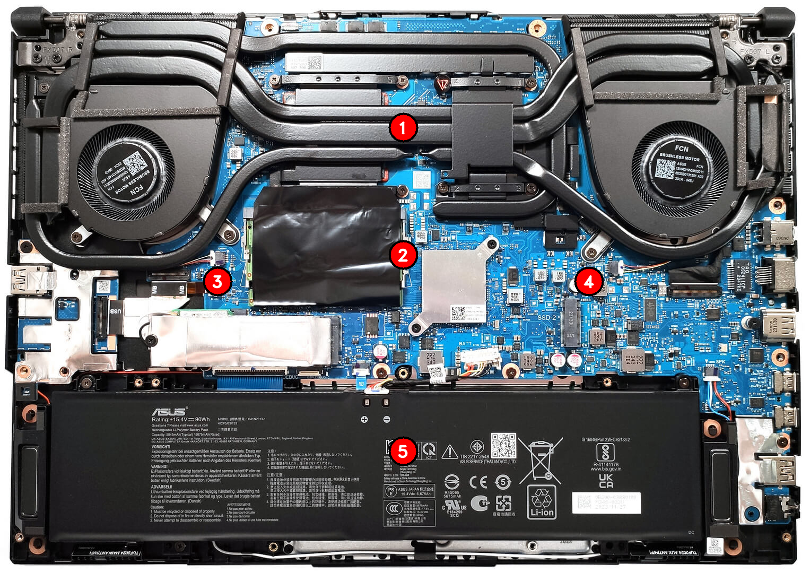

# Lab 03 — Teardown, and the same machine from the command line

## The Machine
- **Model:** ASUS TUF Gaming F16 FX608JMR
- **Manufacturer:** ASUSTeK COMPUTER INC.
- **Form Factor:** Laptop
- **Host OS:** Windows 11 (PowerShell / CIM)
- **Guest OS:** Linux (Ubuntu 24.04 LTS on VMware Workstation)
- **Official Documentation:** [ASUS TUF Gaming F16 Official Spec Page]([suspicious link removed])

> **Note on Service Manual:** ASUS does not publish a public Hardware Maintenance Manual with official exploded-view diagrams. In accordance with course guidelines, the official technical specifications and an open-chassis teardown reference are used.

---

## Part A: Physical Teardown & Upgrade Verdict

### Exploded View / Internal Layout

#### Component Breakdown:
1. **CPU & Discrete GPU (Unified Cooler Module)**
   - **What:** Intel Core i7-14650HX CPU and NVIDIA GeForce RTX 5060 Laptop GPU.
   - **Connects to:** Soldered directly to the mainboard via BGA (Ball Grid Array) sockets beneath shared heat-pipes.
   - **Limits:** Strictly non-removable and non-upgradable.
2. **System Memory (RAM)**
   - **What:** Dual-channel DDR5 SO-DIMM slots.
   - **Connects to:** Two standard 262-pin DDR5 SO-DIMM sockets.
   - **Limits:** Official tested spec supports up to 32 GB (2 × 16 GB), hardware architecture supports up to 64 GB DDR5-5600.
3. **Primary Storage (M.2 NVMe SSD)**
   - **What:** 1 TB PCIe 4.0 NVMe M.2 2280 solid-state drive.
   - **Connects to:** M.2 M-key slot directly wired to PCIe 4.0 lanes.
   - **Limits:** Fully replaceable with any standard M.2 2280 NVMe SSD (up to 2 TB / 4 TB).
4. **Secondary Storage Slot**
   - **What:** Secondary M.2 2280 PCIe 4.0 expansion slot.
   - **Connects to:** Secondary M.2 M-key PCIe bus.
   - **Limits:** Empty from factory; ready for storage upgrade without removing the boot drive.
5. **Battery Pack**
   - **What:** 90 Wh 4-cell Lithium-Ion rechargeable battery.
   - **Connects to:** Dedicated battery power connector on the motherboard.
   - **Limits:** Fastened with screws; replaceable when degraded.

---

### Upgrade Verdict

| Component | Manual / Spec says | OS Command Line says | Verdict |
| :--- | :--- | :--- | :--- |
| **RAM** | 2 × DDR5 SO-DIMM slots, up to 32 GB supported | `Win32_PhysicalMemory`: 2 modules installed (32 GB total), removable form factor | **Yes**: Fully upgradeable by swapping the two SO-DIMM sticks. |
| **Storage (SSD)** | 2 × M.2 2280 PCIe 4.0 NVMe slots | `Get-PhysicalDisk`: 1 physical NVMe drive detected (~1 TB) | **Yes**: Primary drive is swappable, plus an extra empty M.2 slot is available. |
| **CPU** | Mobile Intel BGA processor | `Win32_Processor`: BGA package, mobile socket designation | **No**: Permanently soldered to the system board; upgrade impossible. |

*Discrepancy Explanation:* Firmware/SMBIOS values (`MaxCapacity` in `Win32_PhysicalMemoryArray`) often report the maximum theoretical memory controller limit (e.g., 64 GB or 128 GB), while the manufacturer documentation lists 32 GB as the maximum factory-tested configuration.

---

## Part B: Cross-OS Command Comparison

| Hardware Fact | Windows (Host) | Linux (VMware Guest) |
| :--- | :--- | :--- |
| **CPU Model & Cores** | `Get-CimInstance Win32_Processor \| Select-Object Name, NumberOfCores, NumberOfLogicalProcessors` | `lscpu \| grep -E 'Model name\|CPU\\(s\\):'` |
| **Total Memory** | `(Get-CimInstance Win32_PhysicalMemory \| Measure-Object Capacity -Sum).Sum / 1GB` | `free -h` |
| **Memory Slots / Form** | `Get-CimInstance Win32_PhysicalMemory \| Select-Object DeviceLocator, Capacity, Speed` | `sudo dmidecode -t memory` |
| **Storage Model & Bus** | `Get-PhysicalDisk \| Select-Object FriendlyName, MediaType, BusType, Size` | `lsblk -d -o NAME,MODEL,SIZE,ROTA,TRAN` |
| **Motherboard Identity**| `Get-CimInstance Win32_BaseBoard \| Select-Object Manufacturer, Product` | `sudo dmidecode -t baseboard` |

### Synthesis & OS Differences:
- **Host vs. Virtual Machine:** The Windows host queries report raw physical silicon (ASUSTeK motherboard, physical NVMe storage, DDR5 modules). In contrast, the Linux guest inside VMware sees virtualized hardware abstractions (`VMware Virtual Platform`, virtual SCSI/SATA disks, vCPUs).
- **Units and Reporting:** Windows PowerShell displays raw sizes in decimal bytes by default, requiring division to get gigabytes. Linux tools such as `free -h` report in binary gibibytes (GiB, base-1024), while `lsblk` automatically formats block storage sizes using decimal/human-readable suffixes.

---

## What did not work the first time
1. **Absence of Hardware Maintenance Manual:** ASUS does not publish official component-level service manuals for consumer laptops, so verified technical spec sheets and chassis teardowns were used instead.
2. **Guest-to-Host File Transfer:** VMware cursor integration did not immediately allow clipboard sharing, requiring the use of secure network transfer (`scp` via SSH) between the Linux guest and Windows host.
3. **Privilege Requirements:** Low-level SMBIOS inspection commands in Linux (`dmidecode`) failed without administrative privileges, requiring explicit `sudo` execution to read physical DMI tables.
