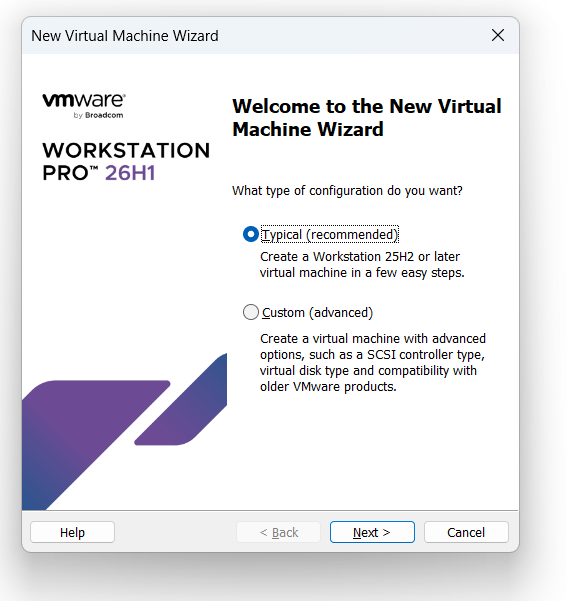
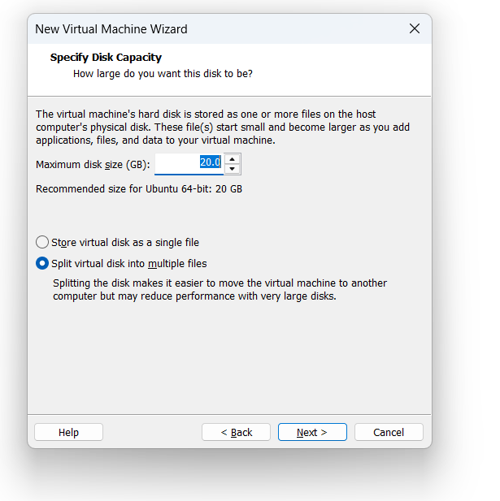
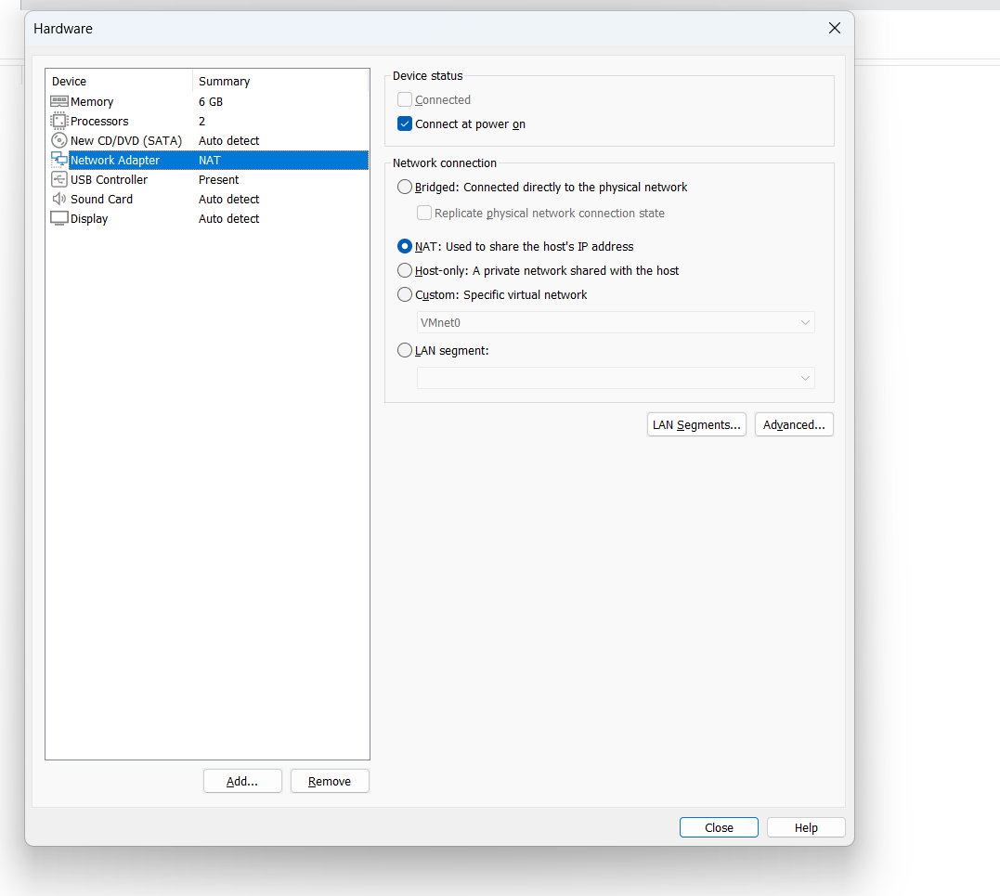

# Step-by-Step Virtual Machine Build Guide

This guide describes how to create and configure a test virtual machine from scratch using VMware Workstation.

## Prerequisites
- **Hypervisor:** VMware Workstation Pro / Player (version 17 or higher)
- **Host OS:** Windows 11 (64-bit)
- **ISO Image:** Ubuntu Server 24.04 LTS (or Ubuntu 22.04 LTS)
- **Available Host Resources:** Minimum 8 GB free RAM, 30 GB free disk space.

---

## Step 1: Launch the New Virtual Machine Wizard
1. Open VMware Workstation.
2. Click **File -> New Virtual Machine** (or press `Ctrl+N`).
3. Select **Typical (recommended)** and click **Next**.
   - *Why:* Typical configuration provides the standard baseline devices suitable for testing without unnecessary complex hardware emulations.



---

## Step 2: Select the Installation Source (ISO)
1. Choose **Installer disc image file (iso)**.
2. Click **Browse...** and select your Ubuntu Server ISO file.
3. Click **Next**.
   - *Why:* Pointing directly to the ISO allows VMware to detect the operating system type and automate pre-configuration.

---

## Step 3: Specify Virtual Machine Name and Location
1. Set the **Virtual machine name** to `osarch-lab01`.
2. Choose a destination folder on your fastest drive (SSD preferred).
3. Click **Next**.
   - *Why:* A clear hostname following the course naming convention prevents confusion when multiple machines are running.

---

## Step 4: Configure Virtual Disk Settings
1. Set **Maximum disk size** to `25.0 GB` (or `20.0 GB`).
2. Select **Store virtual disk as a single file**.
3. Click **Next**.
   - *Why:* 25 GB is sufficient for the OS, build tools, and test environments. Storing the virtual disk as a single file improves read/write performance compared to split files on modern SSDs.



---

## Step 5: Customize Hardware & Allocate Memory
1. On the summary screen, click **Customize Hardware...**.
2. Select **Memory**: set it to **2048 MB (2 GB)** (or 4096 MB depending on your host RAM).
   - *Why:* 2 GB is the recommended minimum for a headless Ubuntu Server. It leaves enough RAM for the host system and the Windows VM to operate without paging.
3. Select **Processors**: allocate **2 vCPUs**.
   - *Why:* 2 cores allow parallel compilation and avoid CPU starvation during background OS updates.

---

## Step 6: Network Adapter Configuration
1. In the same Hardware window, click **Network Adapter**.
2. Select **NAT: Used to share the host's IP address** (VMnet8).
3. Click **Close**, then click **Finish**.
   - *Why:* NAT mode creates an isolated private subnet (`192.168.34.0/24`) behind the host's virtual router. Unlike Bridged mode, NAT prevents IP conflicts and bypasses university Wi-Fi MAC filtering while still providing internet access and inter-guest communication.



---

## Step 7: Complete OS Installation and First Boot
1. Power on the virtual machine.
2. Follow the standard Ubuntu installer prompts:
   - Language: **English**.
   - Network: accept DHCP configuration (`enp0s3` / `ens33`).
   - Profile setup: create your user account (`isko`).
   - Package selection: check **Install OpenSSH server** (needed for remote terminal access).
3. Wait for installation to finish, remove the installation media when prompted, and reboot.

---

## Step 8: Post-Installation Verification
1. Log into your virtual machine using your credentials.
2. Verify the kernel and system architecture:
   ```bash
   uname -a
